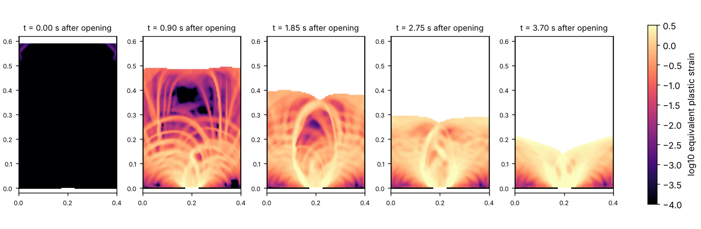
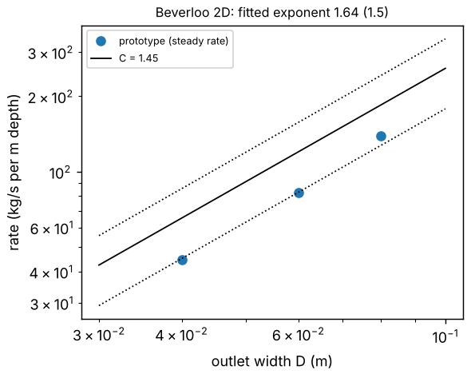

# T0 silo discharge in the 2D prototype (WP 3.3p)

Date: 2026-11-15. Code: `prototype/discharge2d.py` on `prototype/void2d.py` (rules 1 to 10).
Decision: `docs/decisions/0026-silo-outlet-and-discharge-rate.md`.

## Set-up

Tank 0.40 m wide, material to 0.60 m, void above; walls and floor with Coulomb friction
20 deg; outlet centred in the floor, D = 0.04, 0.06 or 0.08 m. Mohr-Coulomb c = 0,
phi 35 deg, psi 0, rho 1800 kg/m3, nu 0.3. Stage 1: gravity ramped over 0.1 s, damping
250 1/s, 0.3 s in all, outlet closed. Stage 2: outlet opens instantly, damping off.

**Stiffness.** These runs use E = 0.1 MPa, not T0's 10 MPa: the rate depends on E
(below), and E = 0.1 MPa is the stiffest value that gives steady flow at an affordable
cost (1 h per run at 5 mm). This is a numerical limitation, not a material choice.

Reproduce (each writes an .npz for the plots):

    python3 prototype/discharge2d.py --run --cell 0.005 --E 1e5 --D 0.06 \
        --frames --frame-dt 0.05 --m-stop 0.3 --save D06.npz
    python3 tools/plot_discharge.py --frames D06.npz --out docs/results/silo-prototype

## Animation

Left: speed; right: equivalent plastic strain (log scale). 5.5 s after opening, 70
percent of the material has left.

## Flow pattern (D = 0.06 m, 5 mm cells)

A fast channel forms above the outlet, the bottom corners stay at rest (corner speed 0.3
percent of the outlet speed at the end of the run) and a crater opens in the free
surface once the flowing zone reaches it (about 2 s after opening). This is the pattern
the references describe (`docs/spec/silo-reference.md` section 3).

## Discharge rate

| D (m) | Rate, 5 mm (kg/s/m) | C (exponent 1.5) | Variation in 0.1 s windows | Beverloo, C = 1.45 (kg/s/m) |
| --- | --- | --- | --- | --- |
| 0.04 | 23.3 | 0.52 | 4.8 % | 65.4 |
| 0.06 | 52.6 | 0.63 | 4.7 % | 120.1 |
| 0.08 | 85.4 | 0.67 | 3.7 % | 185.0 |

Rate measured as the slope of the tank mass from 95 to 70 percent of the mass at
opening. Fitted exponent 1.87 (band 1.3 to 1.7); C 0.52 to 0.67 (band 1.0 to 1.9).

| Check (WP 3.3p brief) | Result | Band | Status |
| --- | --- | --- | --- |
| Nothing leaves before opening | 0 kg exactly | 0 | Pass |
| Mass in tank + discharged | constant to 1e-13 | 1e-8 | Pass |
| Steady rate while the bed is deeper than W | within 5 % (5 mm) | 10 % | Pass |
| Head independence, H 0.9 against 0.6 m | 0.94 (10 mm) | within 10 % | Pass |
| Stagnant corners | 0.3 % of the outlet speed (5 mm, D = 0.06 m) | below 1 % | Pass (10 mm: 1.7 to 2.9 %, fails) |
| Crater | 66 mm deep at the end (D = 0.06 m) | present | Pass |
| Exponent | 1.87 (5 mm), 2.17 (10 mm) | 1.3 to 1.7 | **Fail** |
| C | 0.52 to 0.67 (5 mm) | 1.0 to 1.9 | **Fail** |
| Mesh, 5 against 2.5 mm (D = 0.06 m, 0.2 to 0.5 s) | 51.1 against 57.7 kg/s/m, 13 % | 10 % | **Fail** |

## Why the rate is low: numerical dissipation

The rate depends on E and on the mesh, which a rate-independent material should not do.
D = 0.06 m, 10 mm cells, rate 0.05 to 0.4 s after opening:

| E (MPa) | 0.01 | 0.1 | 1 | 10 (T0) |
| --- | --- | --- | --- | --- |
| Rate (kg/s/m) | 47 rising to 274, not steady | 38 | 17 | 6 |

The acoustic Riemann solver's jump terms act as a viscosity of order rho c h grad v,
which grows with the wave speed c (so with sqrt(E)) and falls with the cell size h.
Reducing these terms speeds the flow up but makes it noisy, because they are also the
only damping of elastic and odd-even modes (table in decision 0026). Also, rate-independent
Coulomb friction does not by itself select a unique flow rate; every continuum reference
value of C used mu(I) rheology. The fix is WP 3.3q (`docs/wp/WP-3.3q.md`): a damping that
does not resist plastic flow, mu(I) friction, or both.

## Cost

Python prototype, one core: 5 mm cells and E = 0.1 MPa run about 230 s of wall time per
second of discharge (80 x 124 cells); 2.5 mm about 8 times that. At T0's E = 10 MPa the
time step is 10 times smaller.
