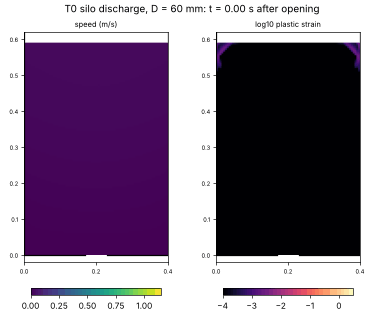
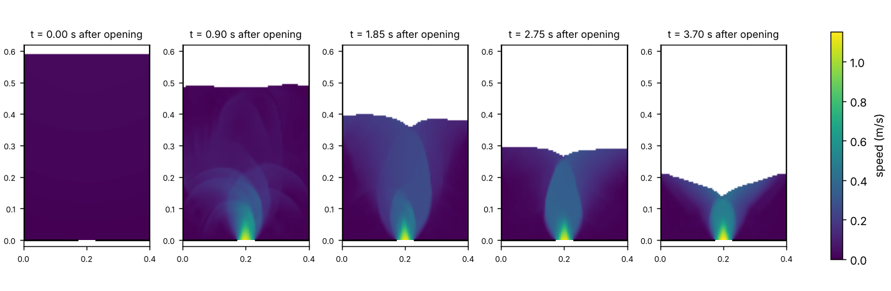
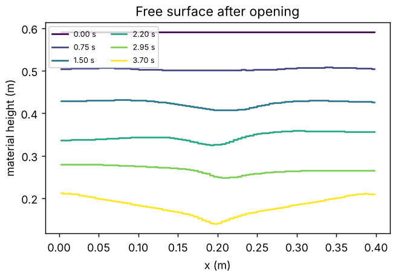
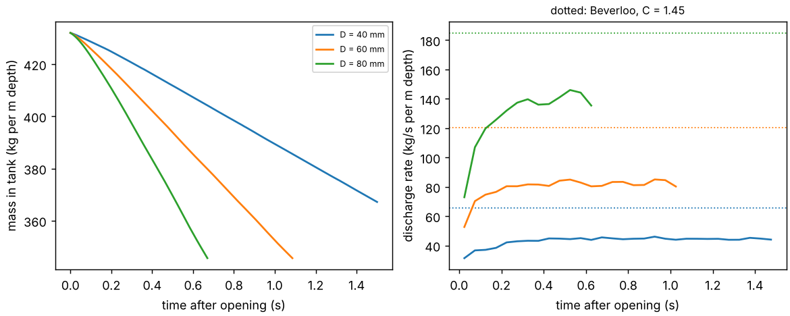

# T0 silo discharge in the 2D prototype (WP 3.3p, 3.3q)

Date: 2026-11-15. Code: `prototype/discharge2d.py` on `prototype/void2d.py` (rules 1 to
10b). Decisions: `docs/decisions/0026-silo-outlet-and-discharge-rate.md` (outlet),
`0027-outlet-void-and-discharge-rate.md` (WP 3.3q: the outlet bug that held the rate at
a third of Beverloo, and the rate-law checks). Every number and figure below is with the
WP 3.3q fix.

## Set-up

Tank 0.40 m wide, material to 0.60 m, void above; walls and floor with Coulomb friction
20 deg; outlet centred in the floor, D = 0.04, 0.06 or 0.08 m. Mohr-Coulomb c = 0,
phi 35 deg, psi 0, rho 1800 kg/m3, nu 0.3. Stage 1: gravity ramped over 0.1 s, damping
250 1/s, 0.3 s in all, outlet closed. Stage 2: outlet opens instantly, damping off.

**Stiffness.** These runs use E = 0.1 MPa, not T0's 10 MPa: the rate still depends on E
(below, WP 3.3r), and stiffer runs cost more (the time step scales with 1 / sqrt(E)).
This is a numerical limitation, not a material choice.

Reproduce (each writes an .npz for the plots):

    python3 prototype/discharge2d.py --run --cell 0.005 --E 1e5 --D 0.06 \
        --frames --frame-dt 0.05 --m-stop 0.3 --save D06.npz      # about 25 min
    python3 tools/plot_discharge.py --frames D06.npz --out docs/results/silo-prototype

## Animation

Left: speed; right: equivalent plastic strain (log scale). Run to 70 percent of the
material discharged.

## Flow pattern (D = 0.06 m, 5 mm cells)

A fast channel forms above the outlet (about 1.1 m/s at the outlet centre), the bottom
corners stay at rest (mean corner speed over 0.3 s 0.06 percent of the outlet speed at
the end of the run, instantaneous 0.85 percent), the bed descends almost flat at first
and a crater opens once the flowing zone reaches the surface (visible from about 1.8 s;
86 mm deep at 3.7 s). This is the funnel-flow pattern the references describe
(`docs/spec/silo-reference.md` section 3). The faint arcs at 0.9 s are elastic waves
from the opening in the soft bed. Rate over the run 82.1 kg/s/m (C 0.99), steady within
3.8 percent from 0.3 to 1.6 s.

## Discharge rate

`tests/test_proto_silo_rate.sh` (5 mm, rate from 97 to 88 percent of the mass at
opening; in CI):

| D (m) | Rate, 5 mm (kg/s/m) | C (exponent 1.5) | Variation in 0.1 s windows | Beverloo, C = 1.45 (kg/s/m) | Before WP 3.3q |
| --- | --- | --- | --- | --- | --- |
| 0.04 | 44.7 | 0.99 | 1.7 % | 65.4 | 14.3 |
| 0.06 | 82.2 | 0.99 | 2.5 % | 120.1 | 36.6 |
| 0.08 | 135.1 | 1.06 | 6.1 % | 185.0 | 68.4 |

Fitted exponent 1.59 (band 1.3 to 1.7), C = 1.035 (band 1.0 to 1.9; thin margin). C
of about 1.0 is below the mu(I) continuum value 1.45, as expected for T0's higher
friction (phi 35 deg against mu_s 0.32 to 0.38, `docs/spec/silo-reference.md` section 3).
The figures above are from runs to 70 to 85 percent of the mass (rate windows from 95
percent), which give the same rates within 3 percent.

| Check | Result | Band | Status |
| --- | --- | --- | --- |
| Nothing leaves before opening | 0 kg exactly | 0 | Pass |
| Mass in tank + discharged | constant to 2e-14 | 1e-8 | Pass |
| Steady rate | within 1.7 to 6.1 % | 10 % | Pass |
| Head independence, H 0.9 against 0.6 m (5 mm) | 0.992 | within 10 % | Pass |
| Stagnant corners (D = 0.06 m, mean over 0.3 s) | 0.83 % of the outlet speed (instantaneous 4.2 %: elastic ringing) | below 1 % | Pass (thin) |
| Crater | 9 mm at the end of the check | present | Pass |
| Exponent | 1.59 | 1.3 to 1.7 | Pass |
| C | 1.035 | 1.0 to 1.9 | Pass |
| Mesh, 10 against 5 mm (D = 0.06 m) | 81.4 against 82.2 kg/s/m, 1 % | 10 % | Pass |
| Mesh, 5 against 2.5 mm (D = 0.06 m, 0.2 to 0.5 s) | 81.5 against 93.3 kg/s/m, 14 % (C 0.98 against 1.13) | 10 % | **Fail** |
| Stiffness (10 mm, D = 0.06 m) | 81 / 73 / 54 kg/s/m at E = 0.1 / 1 / 10 MPa | within 10 % | **Fail** (WP 3.3r) |

At 10 mm the 0.04 m outlet is only 4 cells wide and gives C 0.75 (the 0.06, 0.08 and
0.10 m outlets give 0.98), which is why the rate-law test runs at 5 mm.

## Why the rate was low (fixed in WP 3.3q)

Decision 0026 blamed the Riemann solver's dissipation. The real cause was the outlet: a
partly filled outlet cell leans its material against the cell above (the ghost beyond
the outlet is empty), the outlet face then counted as untouched and got the closed-wall
velocity 0, and the cell was squeezed by the material arriving from above. The outlet
row rang between 0 and 9 kPa and held the column up. With rule 10b (an outlet face
takes the free velocity even when the material leans away) the outlet row carries 0 to
0.2 kPa and the rate roughly doubles to triples.

## Still open: stiffness and fine mesh (WP 3.3r)

The rate still falls with E: 81 / 73 / 54 kg/s/m at E = 0.1 / 1 / 10 MPa (10 mm,
D = 0.06 m). At E = 1 MPa it also falls with refinement (73 at 10 mm, 61 at 5 mm),
while at 0.1 MPa it rises between 5 and 2.5 mm (82 to 93). So it is not simply a
dissipation of order rho c h that refinement removes. Reducing the Riemann jump terms
(rule 11, `DISS_N`, `DISS_T`) still makes the flow noisy (decision 0027).

## Cost

Python prototype, one core (four runs sharing four cores): 5 mm cells and E = 0.1 MPa
run about 400 s of wall time per second of discharge (80 x 124 cells); 2.5 mm about 7
times that. `tests/test_proto_silo_rate.sh` runs its four 5 mm cases in parallel
(1407 s on four shared cores). At T0's E = 10 MPa the
time step is 10 times smaller.
