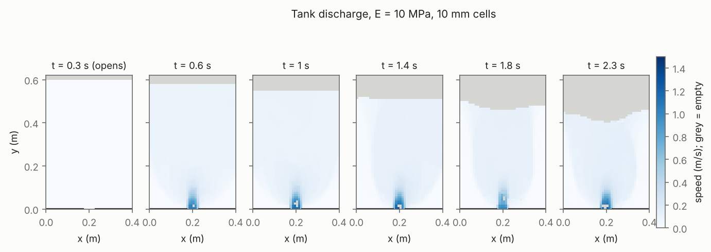
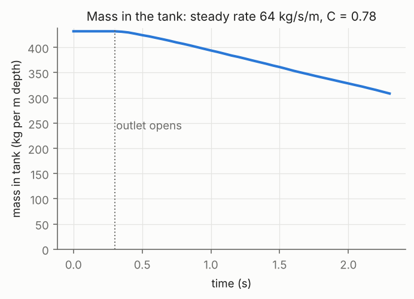
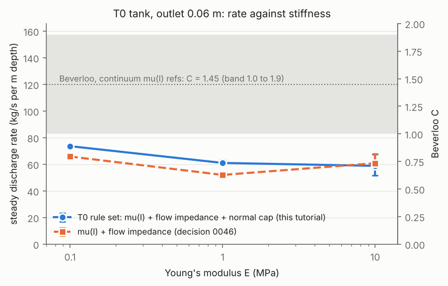

# siloDischarge: Sia's target tank (T0)

A 2D rectangular tank of granular material empties through a small opening in its floor.
The material settles under gravity for 0.3 s with the outlet closed, then the outlet
opens and the material flows out for 2 s.

| | |
| --- | --- |
| Tank | 0.40 m wide, filled to 0.60 m, outlet 0.06 m wide in the middle of the floor |
| Material | rho 1800 kg/m3, E 10 MPa (T0), nu 0.3, Mohr-Coulomb phi 35 deg, c 0 |
| Friction | mu(I): mu_s = tan 35 = 0.70, mu_2 = 0.96, I0 0.279, grains 1 mm (placeholders, decision 0037) |
| Rule set | T0 rule set (decision 0050): mu(I) + `flowImpedance` + `normalCap`, with `shearCap` and `spreadLayers` |
| Walls, floor | friction 20 deg; outlet closed (20 deg) until 0.3 s |
| Mesh | 10 mm square cells, 40 x 62, one cell deep |

## How to run

```bash
source /usr/lib/openfoam/openfoam2512/etc/bashrc   # tools/setup_openfoam.sh installs it
./Allwmake                                          # from the repository root, once
cd tutorials/siloDischarge
./Allrun          # E = 10 MPa, about 11 minutes on one core
./Allrun 0.1      # softer material, about 40 s
./Allrun 10 4     # on 4 processors
python3 plot.py   # snapshots.png, mass.png, rate.txt (needs numpy, matplotlib)
./Allclean
```

The fields (alpha = material fraction, U, sigma, rho) are written every 0.05 s and open
in ParaView (`touch silo.foam; paraview silo.foam`). The mass left in the tank is printed
in `log.celFoam` at each write; `plot.py` turns it into the steady rate.

## What it shows (10 MPa, 10 mm)



The outlet opens at 0.3 s. A fast stream forms above the outlet (dark), with a slower
converging zone around it; the top surface comes down nearly level. Grey cells inside
the stream are void: the material loosens as it speeds up towards the outlet.



After a short start the tank empties at a steady rate (the Beverloo regime, rate
independent of the fill height): about 64 kg/s per metre of depth here (C = 0.78).

## Rate against stiffness



The rate should not depend on E (Sia rejected a soft E as unmeasurable, decision 0036).
Each point is the mean of three runs that differ only in round-off (bars: the range).
With the T0 rule set (blue, decision 0050) the tank gives 73.6 / 61.0 / 58.8 kg/s/m at
0.1 / 1 / 10 MPa: 1 and 10 MPa are about 17 and 20 % below 0.1 MPa, and a single 10 MPa
run can land anywhere from 52 to 68 (this tutorial run gave 64.4). About 20 % is
accepted for now; dilatancy (decision 0048) and a gradual full / partly filled blend
(decision 0049) were tried and did not remove it. The same rule set keeps the inclined
layer within 5 % of the exact flow and puts the column collapse in its experimental
band at T0's E (decision 0050).

Beverloo constant C = rate / (rho sqrt(g) D^1.5) is 0.69 to 0.94, below the band from
the continuum mu(I) papers (C about 1.45; Staron et al. 2014, Zhou et al. 2017, see
`docs/spec/validation-references.md`). Those used a friction of 0.32 to 0.38 against
0.70 here, so a slower flow is expected; C also rises with mesh refinement (0.79 against
0.94 at 5 mm, 0.1 MPa, before the normal cap; now 0.89 at 10 mm, 0.1 MPa).

`rate_vs_E.py` redraws the plot from the numbers of
`tests/manual/test_discharge_scatter.sh`
(`CEL_EXTRA_MATERIAL='normalCap yes;'` for the blue line).

## Dictionaries first used here

All in `constant/materialProperties` (commented there): `freeSurface`, the mu(I)
entries `mu2`, `I0`, `d`, `rhoS`, the switches `shearCap`, `spreadLayers`,
`flowImpedance`, `normalCap`, the `walls` friction list and `outlets` (friction, `openTime`). In
`system/controlDict`: `gravityRamp` (s) and `damping` (1/s, until the outlet opens).
