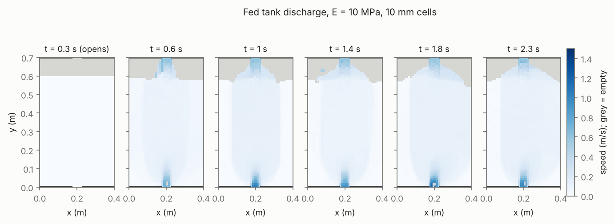
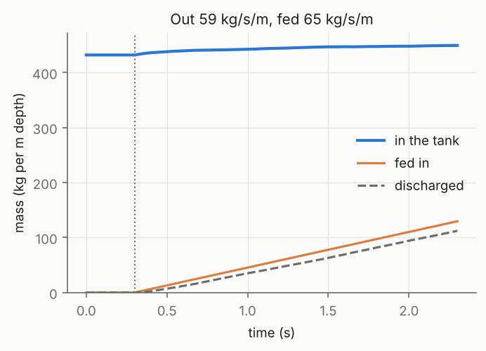

# siloFed: a tank fed from the top while it discharges

Sia's target tank (T0, as `siloDischarge`) with a **solid inlet** in its lid, something
Abaqus CEL cannot do (WP 3.7a/3.7b, decision 0060). The material settles for 0.3 s with
the outlet closed; then the outlet opens and the inlet starts feeding fresh material.

| | |
| --- | --- |
| Tank | 0.40 m wide, filled to 0.60 m, lid at 0.70 m; outlet 0.06 m wide in the middle of the floor |
| Inlet | 0.06 m wide in the middle of the lid, 0.6 m/s from t = 0.3 s: 64.8 kg/s per m of depth |
| Material | rho 1800 kg/m3, E 10 MPa (T0), nu 0.3, Mohr-Coulomb phi 35 deg, c 0, T0 rule set (decision 0050) |
| Walls, floor | friction 20 deg; outlet closed (20 deg) until 0.3 s |
| Mesh | 10 mm square cells, 40 x 70, one cell deep |

## The inlet

New dictionary in `constant/materialProperties` (needs `freeSurface yes`):

```
inlets
{
    inlet                 // patch name; a plain patch, no fixed velocity in 0/U
    {
        speed     0.6;    // [m/s] into the domain, any Function1 of time
                          //   (e.g. speed table ((0 0) (1 0.6));)
        startTime 0.3;    // [s] default 0
        endTime   1e30;   // [s] default never
        density   1800;   // [kg/m3] of the fed material, default rho
        pressure  0;      // [Pa] the fed material's stress is -pressure I, default 0
        friction  0;      // [deg] closed-wall friction outside those times, default 0
    }
}
```

While open, the inlet face moves into the tank at `speed` and the volume it sweeps is
filled with fresh material (no plastic history). The mass fed in is printed as
`Fed mass` in `log.celFoam` at each write, beside `Discharged mass`.

## How to run

```bash
source /usr/lib/openfoam/openfoam2512/etc/bashrc
./Allwmake                    # from the repository root, once
cd tutorials/siloFed
./Allrun                      # E = 10 MPa, about an hour on one core
./Allrun 0.1                  # softer material, a few minutes
./Allrun 10 4                 # on 4 processors
python3 plot.py               # snapshots.png, mass.png, rate.txt (numpy, matplotlib)
./Allclean
```

## What it shows (10 MPa, 10 mm)



The fed stream drops from the inlet onto the surface and builds a heap under it while
the tank drains through the floor. The flow towards the outlet is the same as in
`siloDischarge`.



From 0.35 s after opening: 59.2 kg/s/m out (Beverloo C = 0.71, as the unfed tank at this
E, decision 0050) against 64.8 kg/s/m fed in, so the tank gains slowly (1.04 times its
mass at opening by 2.3 s) and the heap reaches the lid. Tank + discharged - fed is
constant to 9e-13. Set `speed` to the outflow over rho times 0.06 m to hold the level,
or lower to let the tank drain.

`tests/test_fed_silo.sh` checks the same set-up at E = 0.1 MPa: the outflow with a
feed of half and all of the unfed rate is within 3 % of the unfed rate, and the matched
feed holds the tank mass within 1.05 %.
