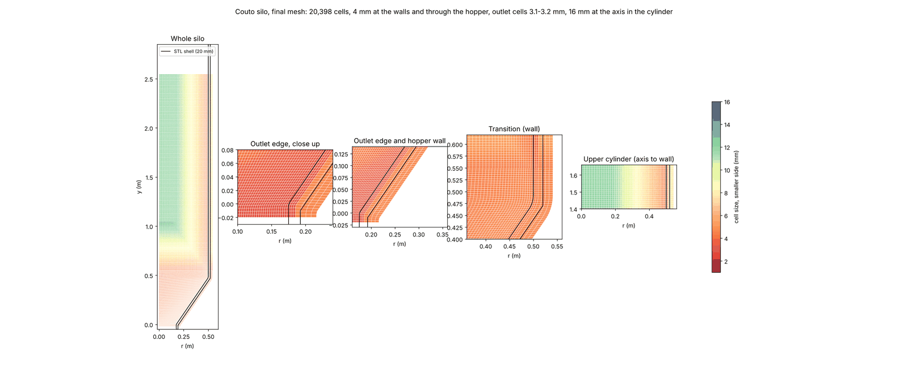
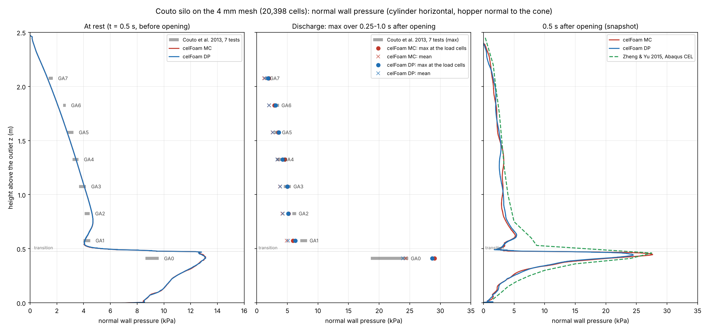
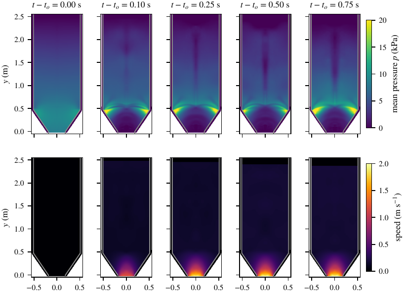
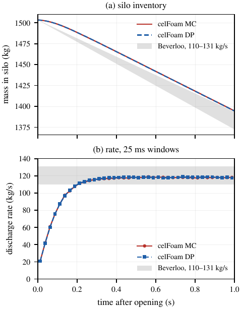

# coutoHopper: the Couto wheat silo (validation case of celFoam 1.0)

The test silo of Couto et al. (2013): a 1 m diameter, 2 m tall cylinder on a conical
hopper (wall at 34.3 deg to the vertical, outlet 0.35 m), full of wheat. The material
settles with the outlet closed for 0.5 s, then the outlet opens and the silo discharges
until 1.5 s. The case runs on an axisymmetric wedge with a wall-aligned blockMesh mesh,
and the silo wall is an STL shell inside the mesh with three buffer cells outside it,
so any leak shows up (decisions 0100, 0107, 0115, 0117).

## Setup

| | |
| --- | --- |
| Material | wheat: rho 856 kg/m3, E 10.7 MPa, nu 0.3, phi 30.17 deg, psi 1 deg, c 0 |
| Models | Mohr-Coulomb (`mc`) or Drucker-Prager, plane-strain fit (`dp`) |
| Flow rules | mu(I) (mu2 0.8412, I0 0.279, d 4 mm), T0 rule set, fullBlend, nonlocal fluidity A 0.48 |
| Walls | STL shell `shell` with friction atan(0.20); outlet `openTime 0.5` |
| Start | gravity on in a full silo (no filling history) |
| Mesh (standard) | 7,584 cells: 25 mm rows in the upper cylinder, outlet cells 3 to 5 mm |
| Mesh (fine) | 20,398 cells: 4 mm through the hopper and at the walls, outlet 3.1 mm |

The case files are generated by the scripts in `tests/hopper/` (they live with the test
suite because the regression tests use them), and run with `celVoidCheck`, the
solver driver that also writes the checkpoints. `celfoam tutorials` copies this folder;
the scripts are found through `$CELFOAM_DIR`.

The outlet is closed (wall friction) while the wheat settles under gravity, switched
on at t = 0 with no filling history, then opens at 0.5 s; the run ends at 1.5 s. Load
cells GA0 (hopper) and GA1 to GA7 (cylinder) are read as the normal wall stress at the
heights of Couto's sensors.

## Numerics

- Explicit Lagrange step plus remap on the fixed mesh (decision 0013): MUSCL-Hancock
  face states with an acoustic Riemann solver, Jaumann stress rate (Hughes-Winget),
  time step from the CFL limit with `maxCo 0.4`.
- Axisymmetric wedge (one cell in the hoop direction, decision 0061) with angled hex
  cells that follow the hopper wall (decisions 0103-0107): the solver treats every
  cell as a general non-orthogonal hex.
- Wheat friction law mu(I) (mu2 0.8412, I0 0.279, d 4 mm) with the T0 rule set
  (`shearCap`, `spreadLayers`, `flowImpedance`, `normalCap`, decision 0050),
  `fullBlend` for partly filled cells and the nonlocal fluidity A 0.48 (decision 0111).
- Drucker-Prager uses the plane-strain fit to Mohr-Coulomb; the compression fit gave
  45 kg/s (decision 0102).
- Settling: gravity ramp and velocity damping until the outlet opens (decision 0020).
- Driver: `celVoidCheck` (same solver library as `celFoam`) with checkpoints every
  0.05 s of simulated time (decision 0117).

## How to run

```bash
celfoam                      # or: source <prefix>/etc/celfoam.sh
cd coutoHopper
./Allrun mc mesh             # build the standard mesh only and check it (seconds)
./Allrun mc mesh-fine        # the same for the fine mesh
./Allrun mc                  # standard mesh, about 2 h on 4 cores
./Allrun dp fine             # the validated fine mesh, about 8 h on 4 cores
CEL_NPROCS=2 ./Allrun mc     # fewer cores (a 2-core laptop takes about 3.6 times longer)
./Allclean
```

`./Allrun` writes a report to `run/<model>.out`: the discharge rate against Beverloo,
the wall pressures at the eight load cells (GA0 on the hopper, GA1 to GA7 up the
cylinder) at rest and in discharge against the measured ranges, and the leak check.
The run checkpoints every 0.05 s of simulated time; if it stops, run the same command
again and it resumes from the latest checkpoint. Open the case in ParaView with
`touch run/couto_mc_aligned_buffered/case.foam`.

## Expected results

Fine mesh (decision 0117, runs of 2026-11-23, PR #78):

| Quantity | Reference | MC | DP |
| --- | --- | --- | --- |
| Discharge rate, kg/s | Beverloo 110-131 | 118.1 | 118.2 |
| GA1 to GA5 at rest | Couto's measured range | inside or within 4 % | same |
| GA0 at rest, kPa | Couto 8.61-9.61 | 13.05 (+36 %) | 13.04 (+36 %) |
| Discharge maxima, GA0 to GA7 | Couto's maxima | within 17 % | within 16 % |
| Transition peak 0.5 s after opening | Abaqus (Zheng and Yu 2015) 27.5 kPa | 27.7 kPa | 24.5 kPa |





The full table and the comparison with both papers are on the manual's Validation page
(`docs/manual/validation.html`). Known gap: GA0 at rest is 36 % high because the
gravity-on start has no filling history (see the release notes).



Mean pressure (top) and speed (bottom) at 0, 0.10, 0.25, 0.50 and 0.75 s after the
outlet opens, Mohr-Coulomb. A stress arch forms at the cylinder-hopper transition
within 0.1 s of opening, the switch pressure of silo theory, and the flow converges
on the outlet.



Silo inventory and discharge rate (25 ms windows) for both models: the rate settles
at 118 kg/s from about 0.3 s after opening, inside the Beverloo band 110-131 kg/s,
and MC and DP agree within 0.1 %. Mass is conserved to 1e-11 kg and nothing leaks
through the STL shell (mass outside it stays 0).

On the standard mesh (7,584 cells) the rate was 124 kg/s (MC) and 110 kg/s (DP) when
it was set up (decision 0107). The outlet cell size sets the rate more than anything
else: keep outlet cells at 3 to 5 mm.

## References

- A. Couto, A. Ruiz, P. J. Aguado (2013). Experimental study of the pressures exerted by
  wheat stored in slender cylindrical silos, varying the flow rate of material during
  discharge. Comparison with Eurocode 1 part 4. Powder Technology 237, 450-467.
  doi:10.1016/j.powtec.2012.12.030
- Q. J. Zheng, A. B. Yu (2015). Finite element investigation of the flow and stress
  patterns in conical hopper during discharge. Chemical Engineering Science 129, 49-57.
  doi:10.1016/j.ces.2015.02.022
