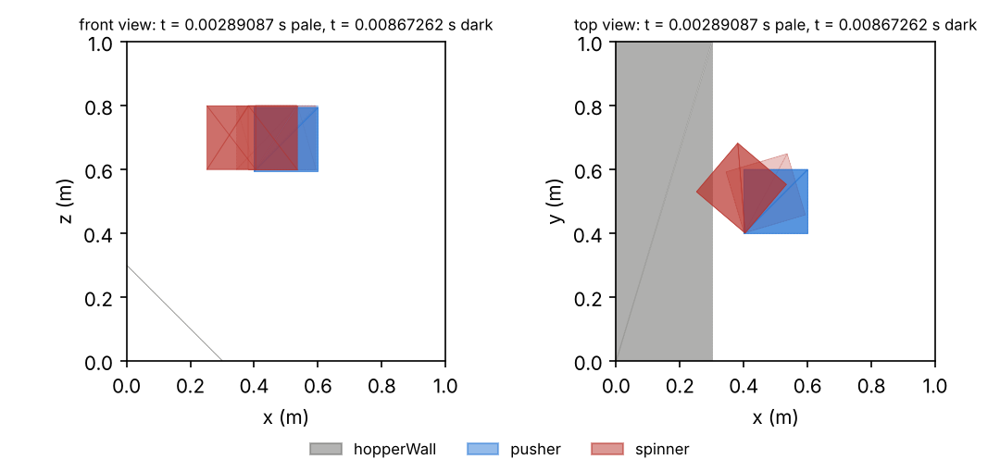

# rigidBodyMotion: prescribed rigid bodies from STL files

Three rigid bodies given as STL surfaces in an elastic block: a fixed 45 deg wall, a
cube pushed down, and a cube that translates and spins. It shows the
`constant/rigidBodies` dictionary (WP 4.1, decision 0041), the kinematics every
moving body uses, and the body output in `postProcessing/rigidBodies`.

## Setup

| | |
| --- | --- |
| Domain | 1 m cube, 10 x 10 x 10 cells of 0.1 m, elastic material as `smokeBox` |
| `hopperWall` | `hopperWall.stl`, fixed (no velocity) |
| `pusher` | `cube.stl`, velocity ramps from 0 to (0 0 -1) m/s over 5 ms, then constant |
| `spinner` | `cube.stl`, velocity (0.5 0 0) m/s and omega (0 0 100) rad/s about (0.4 0.4 0.7) |
| Time | 0 to 0.01 s |

`constant/rigidBodies` documents every keyword in its header: `surface`, `centre`,
`velocity` and `omega` (any OpenFOAM Function1), `friction`, `adhesion`, free bodies
(`mass`, `inertia`) and deformable hex8 bodies (`deformable`).

## Numerics

Body positions are the exact integral of the prescribed velocity; rotation is exact
while the axis of omega stays fixed. Bodies cut the mesh as immersed walls (decisions
0041, 0047). The time step comes from the material's CFL limit.

## How to run

```bash
celfoam tutorials ~/celfoam-cases && cd ~/celfoam-cases/solid/rigidBodyMotion
celfoam ./Allrun          # seconds
celfoam python3 plot.py   # bodies.png (needs numpy, matplotlib)
./Allclean
```

## Expected results



Front and top views at the first body output (2.9 ms, pale) and the last (8.7 ms,
dark), run of 2026-11-27. Over those 5.8 ms the spinner has moved 2.9 mm along x and
turned by 0.58 rad (33 deg) about its vertical edge (top view); the pusher has moved
down 5.8 mm (too little to see at this scale); the wall has not moved.
`postProcessing/rigidBodies/<name>.dat` lists the centre, rotation and velocities at
each write. `tests/test_rigid_body.sh` checks these motions to round-off, serial and on
2 processors.
