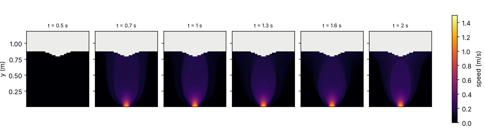
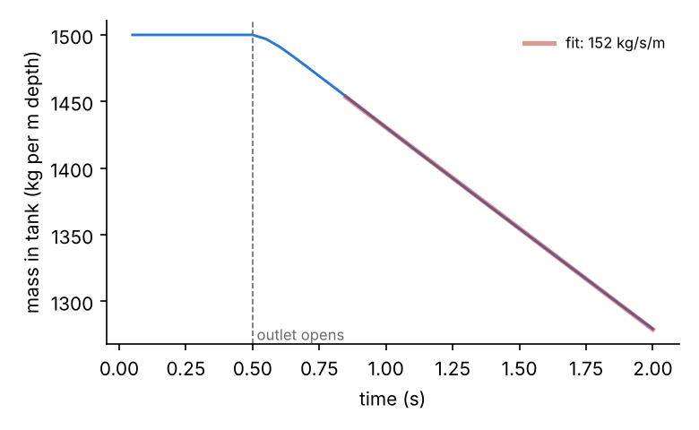

# setupPlaneTank: a case written by the setup tool

A plane (2D) tank with a small bottom opening, written from a short YAML file by
`celfoam setup` (the case generator of WP S.1 and G.7, decisions 0119-0122), meshed
with blockMesh, filled, checked with `celfoam check` and run. The material settles with
the outlet closed, then the outlet opens and the tank discharges. Use it as the template
for your own tank: edit `planeTank.yaml` (or open it in the setup page) and run again.

## Setup

Everything is in `planeTank.yaml`:

| | |
| --- | --- |
| Geometry | template `flatBottom`, shape `plane`: tank 1.0 m wide, 1.2 m tall, outlet 0.1 m wide, filled to 1.0 m; half the tank is meshed (symmetry plane on the axis) |
| Material | Mohr-Coulomb, rho 1500 kg/m3, E 5 MPa, nu 0.3, phi 30 deg, psi 1 deg, c 0 (placeholder sand); mu(I) with grain size d 4 mm |
| Walls | friction 20 deg |
| Mesh | preset `standard`: 4 mm at the outlet growing to 20 mm, one cell deep |
| Run | outlet opens at 0.5 s, end 2.0 s, writes every 0.05 s |

`celfoam setup --describe flatBottom` lists every key with its default and unit.

## Numerics

The setup tool writes the validated hopper settings (decision 0119):

- Explicit Lagrange step plus remap (decision 0013), `maxCo 0.4`.
- T0 rule set (mu(I), `shearCap`, `spreadLayers`, `flowImpedance`, `normalCap`, decision
  0050) and `fullBlend` for partly filled cells (decision 0107).
- Settling with the gravity ramp and damping until the outlet opens (decision 0020).
- `celfoam check` (celCheck, decision 0121) checks the mesh, the time step, the outlet
  cell size against the grain size and the dictionaries before the run.
- Checkpoints: every write is a restart point; `./Allrun` again resumes from the last
  write (`startFrom latestTime`).

## How to run

```bash
celfoam tutorials ~/celfoam-cases && cd ~/celfoam-cases/solid/setupPlaneTank
celfoam ./Allrun          # writes ./case, checks it, runs 2 s (about 1 h on one core)
celfoam ./Allrun 0.1      # a short check: 0.1 s simulated (minutes)
celfoam python3 plot.py   # snapshots.png, mass.png, rate.txt (needs numpy, matplotlib)
celfoam setup --gui planeTank.yaml   # edit the case in the setup page instead
./Allclean
```

In a source checkout run `./Allrun` here after sourcing OpenFOAM; it uses
`../../../tools`.

## Expected results

Run of 2026-11-27 (2 s simulated, one core):



Material coloured by speed from the opening (0.5 s) to the end, the meshed half
mirrored about the axis. The flow converges on the outlet in a narrow funnel; the top
surface sinks first above the outlet.



After a start-up of about 0.3 s the tank empties at a steady **152 kg/s per metre of
depth** (fit from 97 % to 85 % of the mass at opening), Beverloo C = 1.02 for a 0.1 m
slot (inside the 1.0 to 1.9 band of decision 0019). `plot.py` writes the
numbers to `rate.txt`.
