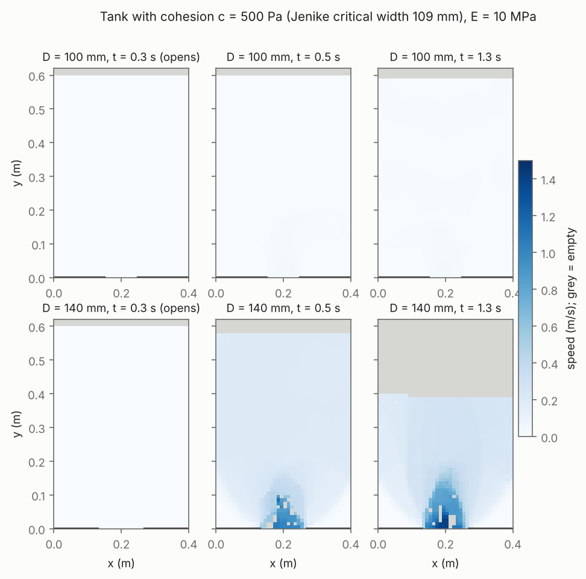
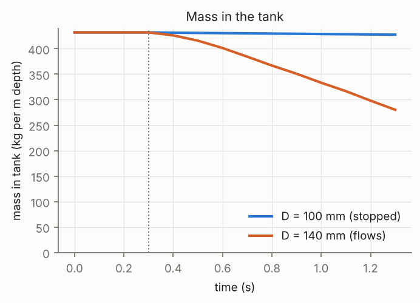

# siloCohesion: the T0 tank with cohesion

Sia's target tank (T0, `tutorials/siloDischarge`) with a cohesive material: c = 500 Pa
instead of 0. The material settles for 0.3 s with the outlet closed, then the outlet
opens. With a narrow outlet the material arches over it and the flow stops; with a wide
one it flows. Allrun runs two outlet widths side by side.

## Setup

| | |
| --- | --- |
| Tank | 0.40 m wide, filled to 0.60 m, outlet centred in the floor: 100 mm and 140 mm |
| Material | rho 1800 kg/m3, E 10 MPa (T0), nu 0.3, Mohr-Coulomb phi 35 deg, c 500 Pa (placeholder) |
| Tensile strength | c cot(phi) = 714 Pa (default; `sigmaT` sets another value) |
| Friction | mu(I) placeholders as `siloDischarge` (decision 0037) |
| Rule set | T0 rule set (decision 0050) |
| Walls, floor | friction 20 deg; outlet closed until 0.3 s; walls have no adhesion |
| Mesh | 10 mm square cells, 40 x 62, one cell deep |

Jenike's critical width for a slot outlet is B_c = sigma_c / (rho g), with the
unconfined strength sigma_c = 2 c cos(phi) / (1 - sin(phi)) = 1920 Pa here: B_c = 109 mm.
Below it a cohesive arch can carry the material above the outlet; above it, it cannot.

## Numerics

- Explicit Lagrange step plus remap onto the fixed mesh (decision 0013): MUSCL-Hancock
  face states with an acoustic Riemann solver, Jaumann stress rate (Hughes-Winget),
  time step from the CFL limit with `maxCo 0.4` (`system/controlDict`).
- Remap: unsplit, face based; default limiters (MC for the main fields, superbee for the
  plastic history, decision 0017).
- Material plus void with the free-surface rules (decisions 0021-0028); the T0 rule set:
  mu(I) friction with `shearCap`, `spreadLayers`, `flowImpedance` and `normalCap`
  (decision 0050).
- Settling: gravity ramps in over 0.1 s (`gravityRamp`) and the velocity is damped at
  250 1/s (`damping`) until the outlet opens (decision 0020). The outlet is a wall with
  friction until `openTime`, then an outflow face (decisions 0026, 0027).
- Cohesion: contact faces carry tension up to `sigmaT` (default c cot(phi)) and tear
  beyond it; a cell stretched beyond it opens void (decision 0054).

## How to run

```bash
source /usr/lib/openfoam/openfoam2512/etc/bashrc   # tools/setup_openfoam.sh installs it
./Allwmake                                          # from the repository root, once
cd tutorials/solid/siloCohesion
./Allrun                # outlets 100 and 140 mm, side by side (folders D100, D140)
./Allrun "60 100 140"   # other widths: multiples of 20 mm
python3 plot.py         # snapshots.png, mass.png, result.txt (needs numpy, matplotlib)
./Allclean
```

Change `c` (and optionally `sigmaT`) in `constant/materialProperties` before `./Allrun`
to try another cohesion; `E` 1e6 runs about three times faster and gives the same
critical width (decision 0054).

## Expected results



The outlet opens at 0.3 s. With 100 mm (below Jenike's 109 mm, top row) a small piece
drops out of the opening and the rest stays put: the cohesive material arches over the
outlet. With 140 mm (bottom row) a flowing zone forms above the outlet and the tank
empties; grey cells inside the stream are void, where the material tears apart at its
tensile strength.



| Outlet | Discharged in 1 s | Rate over the last 0.2 s |
| --- | --- | --- |
| 100 mm | 1.0 % of the fill | 4.2 kg/s/m (2.3 % of Beverloo with C = 1): stopped |
| 140 mm | 35 % of the fill | 183 kg/s/m (62 % of Beverloo with C = 1): flows |

Run of 2026-11-27 (E 10 MPa, 10 mm).

The stopped tank still creeps slowly (a known issue, decision 0054). The test
`tests/test_cohesion.sh` brackets the critical width at c = 500 Pa between 100 and
120 mm (Jenike 109 mm), at E = 1 and 10 MPa; at c = 250 Pa it lies between 40 and 60 mm
(Jenike 55 mm).

## Dictionaries first used here

`c` was already an entry of the Mohr-Coulomb model; since WP 3.5 (decision 0054) it also
sets the tensile strength of the free-surface rules: contact faces between material
cells carry tension up to `sigmaT` (default c cot(phi)) and tear beyond it, and a cell
stretched beyond it opens void. With c = 0 (or `sigmaT 0`) the material separates as
soon as it pulls, as in `siloDischarge`.
