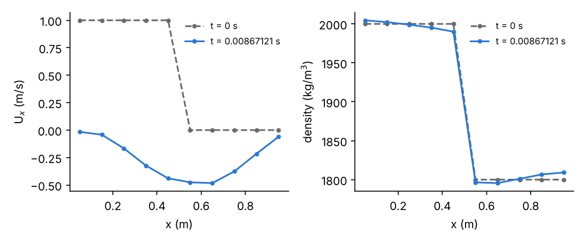

# smokeBox: install check on an elastic box

The smallest celFoam case: a 1 m elastic cube, half of it denser and moving at 1 m/s.
It runs in about a second and is the install's smoke test (`celfoam test` runs
`tests/test_smokeBox.sh` on it). Use it to check that celFoam starts and writes fields.

## Setup

| | |
| --- | --- |
| Domain | 1 m cube, 10 x 10 x 10 cells of 0.1 m (blockMesh), all faces walls |
| Material | linear elastic: rho 1800 kg/m3, E 10 MPa, nu 0.3 (`constant/materialProperties`) |
| Start | `setFields`: x < 0.5 m has rho 2000 kg/m3 and U (1 0 0) m/s; the rest is at rest |
| Time | 0 to 0.01 s |

## Numerics

The default explicit cycle (decision 0013): Lagrange step with MUSCL-Hancock face
states and the acoustic Riemann solver, then the remap onto the fixed mesh; time step
from the CFL limit (`maxCo` default 0.4). No gravity, no free surface.

## How to run

```bash
celfoam tutorials ~/celfoam-cases && cd ~/celfoam-cases/solid/smokeBox
celfoam ./Allrun          # about a second
celfoam python3 plot.py   # profiles.png (needs numpy, matplotlib)
./Allclean
```

In a source checkout: `source /usr/lib/openfoam/openfoam2512/etc/bashrc`, then
`./Allrun` here.

## Expected results



Velocity and density along x, averaged over y and z, at the start and at the last
write (8.7 ms, run of 2026-11-27). The jump at x = 0.5 m sends compression waves both
ways at the P-wave speed (about 87 m/s); they reach the walls after about 6 ms and
reflect, so by the last write the dense half has been brought to rest and pushed back
(U_x about -0.5 m/s in the middle) while the density step stays sharp: the remap moves
only what the material carries. `log.celFoam` ends with `End` and the total mass
printed at each write stays the same.
