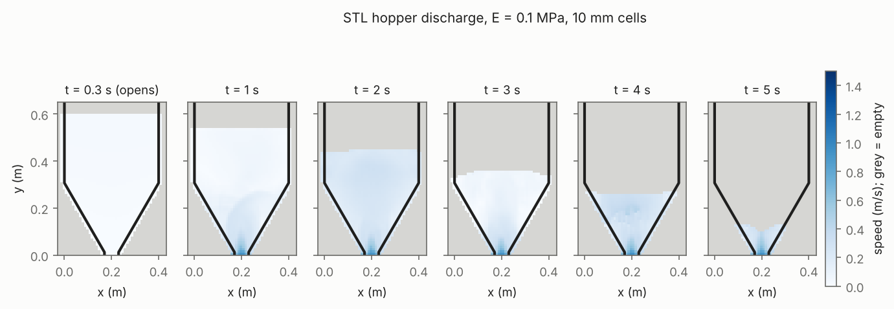
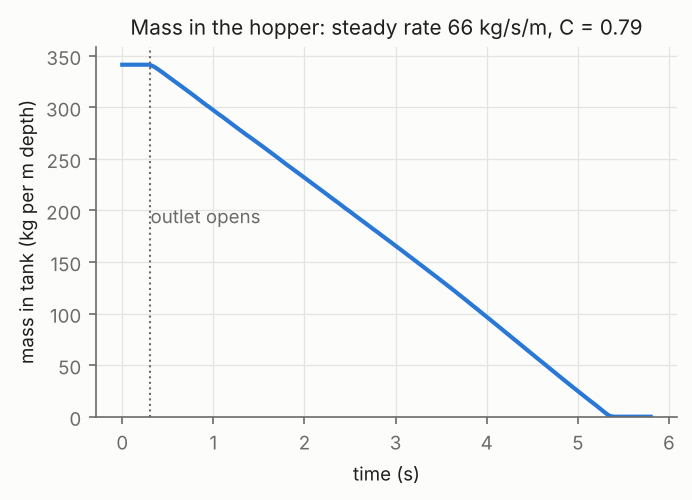

# stlHopper: a 60 deg hopper from STL walls

The stlSilo tank (T0 material) with its flat floor replaced by two STL hopper walls at
60 deg to the horizontal (half angle 30 deg), meeting the side walls at y = 0.32 m and
leaving a 0.06 m gap over the mesh outlet patch (WP 4.5, decisions 0047, 0051, 0052).
The hopper walls cut the 10 mm mesh at every angle. Material settles for 0.3 s with the
outlet closed, then the hopper runs empty.

## Setup

| | |
| --- | --- |
| Walls | STL bodies `leftWall`, `rightWall`, `leftHopper`, `rightHopper` (constant/triSurface), friction 20 deg |
| Fill | to y = 0.61 m, void above |
| Material | as siloDischarge (Mohr-Coulomb phi 35, c 0, mu(I) placeholders); E = 0.1 MPa by default |
| Mesh | 46 x 65 cells of 10 mm, one cell deep |

## Numerics

- Explicit Lagrange step plus remap onto the fixed mesh (decision 0013): MUSCL-Hancock
  face states with an acoustic Riemann solver, Jaumann stress rate (Hughes-Winget),
  time step from the CFL limit with `maxCo 0.4` (`system/controlDict`).
- Remap: unsplit, face based; default limiters (MC for the main fields, superbee for the
  plastic history, decision 0017).
- Material plus void with the free-surface rules (decisions 0021-0028); the T0 rule set:
  mu(I) friction with `shearCap`, `spreadLayers`, `flowImpedance` and `normalCap`
  (decision 0050).
- Settling: gravity ramps in over 0.1 s (`gravityRamp`) and the velocity is damped at
  250 1/s (`damping`) until the outlet opens (decision 0020). The outlet is a wall with
  friction until `openTime`, then an outflow face (decisions 0026, 0027).
- STL walls are immersed cut cells (decisions 0047, 0051, 0052): the 60 deg hopper
  walls cut the square cells at every angle; small cut cells are merged with a
  neighbour in the Lagrange step.

## How to run

```bash
source /usr/lib/openfoam/openfoam2512/etc/bashrc
cd tutorials/solid/stlHopper
./Allrun          # E = 0.1 MPa, runs to empty, about 2 minutes
./Allrun 10       # T0 stiffness, about 25 minutes
python3 plot.py   # snapshots.png, mass.png, rate.txt (needs numpy, matplotlib)
./Allclean
```

## Expected results





- Mass flow: the whole fill moves and the hopper empties completely (no dead zones on
  the 60 deg walls), 5 s after opening.
- Steady rate 65.7 kg/s per metre of depth (C = 0.79, run of 2026-11-27), the same as the flat STL tank (68.8, bands of
  three runs, `tests/test_stl_silo.sh`). The Rose-Tanaka correlation predicts about
  1.2 times the flat-bottom rate for a 30 deg half angle; the correlations are for 3D
  orifices and measured materials, so no pass band is set until Sia agrees one.
