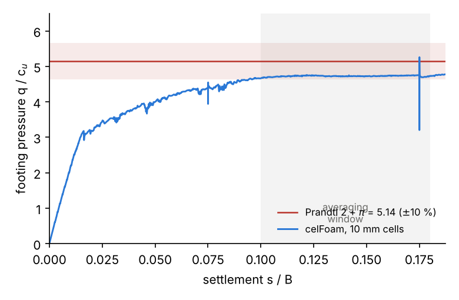
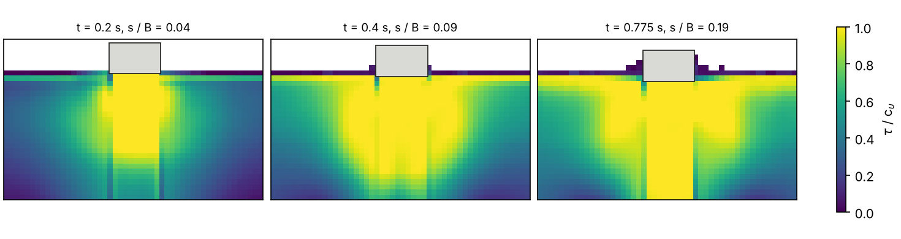

# stripFooting: a rigid footing pushed into clay

The coupled Eulerian-Lagrangian case: a rigid strip footing, given as a moving STL
body, is pushed into undrained clay held on the fixed Eulerian mesh, and the force on
the footing is compared with Prandtl's bearing capacity q = (2 + pi) c_u (WP 4.4,
decisions 0053, 0055). This is the classic CEL benchmark of Abaqus/Explicit.

## Setup

| | |
| --- | --- |
| Box | 0.6 m wide, 0.3 m of clay plus 4 rows of void above, frictionless mesh walls, plane strain |
| Clay | weightless Tresca: Mohr-Coulomb with phi 0, c = c_u = 10 kPa, psi 0, E 3 MPa (E/c_u 300), nu 0.3, rho 1800 kg/m3 |
| Footing | smooth rigid STL box, B = 0.1 m, sides cutting cells at a quarter, base 2.5 mm below the surface |
| Loading | footing speed ramps from 0 to 0.025 m/s over 0.05 s, then constant, to a settlement of 0.19 B (0.775 s) |
| Mesh | 10 mm square cells (60 x 34); `--fine`: 5 mm (120 x 68) |

The case files are written by `tests/footing/footing_checks.py` (shared with the
regression test) through `run_footing.py`, which also asks for snapshots at 0.2, 0.4
and 0.775 s. The driver is `celVoidCheck` (the celFoam solver library with the
force and mass history the check reads).

## Numerics

- Explicit Lagrange step plus remap (decision 0013), `maxCo 0.4`, no gravity.
- The footing is an immersed moving wall: cells it cuts have open areas and volumes,
  cells it uncovers or covers hand their material over without loss (moving cut cells,
  decision 0053). The force on the body is the sum of the wall-face tractions.
- The speed is low enough to be quasi-static (0.05 m/s gives 4 % more).

## How to run

```bash
celfoam tutorials ~/celfoam-cases && cd ~/celfoam-cases/solid/stripFooting
celfoam ./Allrun          # 10 mm cells, about 1 minute; also draws the figures
celfoam ./Allrun --fine   # 5 mm cells, about 9 minutes
./Allclean
```

`run/footing.out` is the report: q / c_u through the push and the mean over
s = 0.10 B to 0.18 B against Prandtl. `run/footing/q.dat` holds the curve.

## Expected results

Run of 2026-11-27, 10 mm cells (65 s):

| Settlement s / B | 0.01 | 0.02 | 0.05 | 0.10 | 0.15 | 0.18 |
| --- | --- | --- | --- | --- | --- | --- |
| q / c_u | 2.18 | 3.18 | 4.00 | 4.66 | 4.72 | 4.73 |

Mean over s = 0.10 B to 0.18 B: **4.73, -8.1 % from Prandtl's 5.14** (test band 10 %),
flat within 0.4 % across that window. With 5 mm cells it reads 5.04 (-1.9 %, decision
0055), so the gap closes with the mesh. Mass is kept to 3e-14 and nothing is lost when
the footing covers cells.





Mobilised shear tau / c_u (yellow = at yield) at three settlements: the plastic zone
starts at the footing edges, spreads into the Prandtl fan and reaches the base of the
0.3 m layer by s = 0.1 B; the clay heaves beside the footing.
