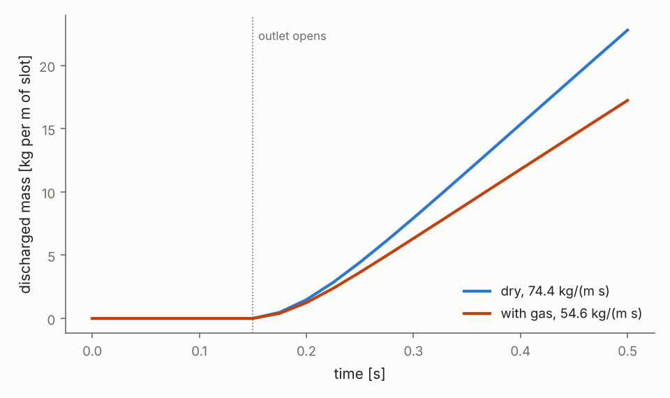
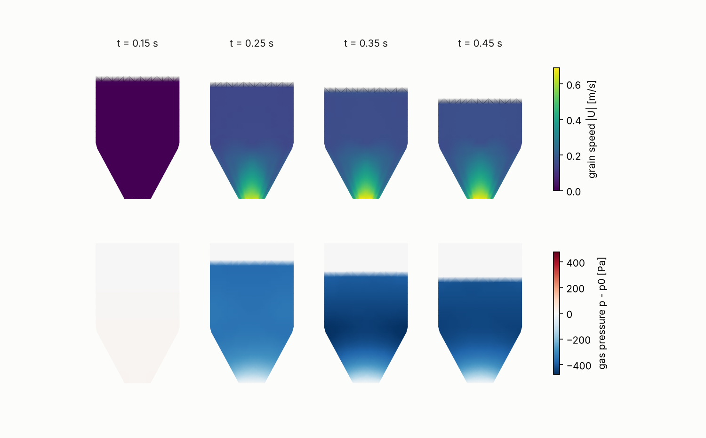

# airImpededHopper: fine sand discharging against the air in its pores

A plane-flow (slot) hopper of fine quartz sand, run twice: with the gas in the pores
(version 2) and dry. When fine grains flow out, the material dilates near the outlet;
air has to flow in through the narrow pores to fill the new pore volume, and the
pressure drop that drives it holds the grains back. The finer the grains, the slower
the discharge (WP F.5, decision 0130).

## Setup

| | |
| --- | --- |
| Hopper | plane flow, bin 0.20 m wide and 0.20 m high above a hopper with walls 30 deg from vertical down to a 60 mm slot (outlet) |
| Fill | 0.15 m above the transition, gas fraction 0.40 (bulk density 1590 kg/m3) |
| Grains | quartz, 2650 kg/m3, diameter 0.2 mm (`./Allrun <d in mm>` changes it) |
| Material | Mohr-Coulomb phi 30 deg, c 0, psi 1 deg, E 1 MPa, nu 0.3; v1's T0 rule set (decision 0050) with mu(I) at the grain diameter |
| Walls | friction 20 deg; the outlet is a wall until 0.15 s, then opens |
| Gas | air at 20 C, atmospheric (gauge 0) at the top and the outlet; walls carry no gas; drag law `ergunWenYu` |
| Mesh | body-fitted blockMesh, 544 cells: 16 columns that fan out from the slot, rows graded 4:1 towards the outlet; one cell (12.5 mm) deep |

The material settles under gravity with the outlet closed (velocity damped at 50 1/s),
then the outlet opens at 0.15 s and the run continues to 0.5 s. `dry/` is the same case
without `constant/gasProperties`.

## The gas input

`constant/gasProperties` switches the gas on; without it celFoam runs exactly as
version 1. The file of this case, commented:

```
model    poreGas;       // pore pressure; gasFlow adds gas momentum (WP F.6, F.7)
rhoP     2650.0;        // grain density [kg/m^3]: solids fraction rho/rhoP
d        0.0002;        // grain diameter [m]: the permeability (Ergun)
T        293.15;        // gas temperature [K]
p0       101325.0;      // reference pressure [Pa]; the field p is gauge
drag     ergunWenYu;    // or ergun, wenYu, diFelice, syamlalOBrien, beetstra
coupled  yes;           // two-way: sigma is the effective stress
```

`0/p` holds the gauge gas pressure and its boundary conditions: `fixedValue` 0 where the
gas meets the atmosphere (`top`, `outlet`; an outlet must be fixedValue), `zeroGradient`
on walls (no gas through them). All keywords are in the manual (case setup, gas).

## Numerics

- The solid as in version 1: explicit Lagrange step plus remap, acoustic Riemann
  solver, CFL time step (`maxCo 0.4`).
- After each solid step the pore gas pressure is solved implicitly over the same step
  (WP F.2, decision 0127): gas mass balance with the flux law q = -lambda grad p, the
  mobility lambda from the drag law at each face, Newton iterations with Anderson
  acceleration to `pTolerance` (1e-6 Pa by default), PCG for each correction.
- Coupling (WP F.3, decision 0128): sigma is the effective stress; the grains feel
  -grad p through the face pressures, and their volume change and motion carry and
  squeeze the gas (gas mass conserved to round-off).
- Free surface and void (WP F.4, decision 0129): cells below alpha 1e-4 are void at the
  atmosphere's pressure; the open outlet holds p = 0.
- Range of validity (decision 0135): the grains stay at their packed density, so the
  model holds while the gas does not lift or expand the bed; the lift check prints the
  share of the grain mass whose weight the gas carries (`Gas lift:` in `log.celFoam`).

## How to run

```bash
source /usr/lib/openfoam/openfoam2512/etc/bashrc   # tools/setup_openfoam.sh installs it
./Allwmake                                          # from the repository root, once
cd tutorials/solidFluid/airImpededHopper
./Allrun          # 0.2 mm grains: the case with gas, then dry/; about 2 minutes
./Allrun 1        # 1 mm grains: the gas hardly acts (-2 %)
./Allrun 0.2 2    # on 2 processors
python3 plot.py   # discharge.png, snapshots.png, discharge.txt (numpy, matplotlib)
./Allclean
```

`log.celFoam` prints at each write the discharged mass and, each step, the gas solve
(`Pore gas: n solves ..., mass ... kg, net in ... kg`: the gas mass less what came in
stays constant to round-off). To continue a run, set `startFrom latestTime;` and a later
`endTime`: celFoam writes the gas solver's state with the fields
(`<time>/uniform/poreGas`, WP F.9) and the restarted run matches the continuous one bit
for bit.

## Expected results



The outlet opens at 0.15 s. Dry, the hopper settles into a steady rate of
74.4 kg/(m s) (Beverloo's slot rate 75.1). With the gas, the 0.2 mm sand flows at
54.6 kg/(m s), 27 % slower (run of 2026-11-27).



Before the outlet opens (0.15 s) the gas is a little above atmospheric: the settling
compacted the bed. Once the material flows, it dilates above the outlet and the pore
pressure falls below atmospheric through the whole bed (blue, down to about -450 Pa): air is
drawn in from the outlet and from the top surface, and the upward pressure gradient over
the outlet region slows the grains.

The rate against grain size (`tests/test_air_impeded.sh`, same case): +0.1 % of dry at
4 mm, -2 % at 1 mm, -5 % at 0.5 mm, -27 % at 0.2 mm and -64 % at 0.1 mm, the trend of the
published experiments (Hsiau et al. 2010; Crewdson et al. 1977). At 0.1 mm (`./Allrun
0.1`) the lift check warns from about 0.23 s: just above the outlet the gas carries the
weight of about 2 % of the grains, which would loosen there in reality, and the model
keeps them at their packed density, so read the 0.1 mm rate as an estimate.

Gas on costs about 1.6 times a dry step here (70 s against 43 s on one core).
