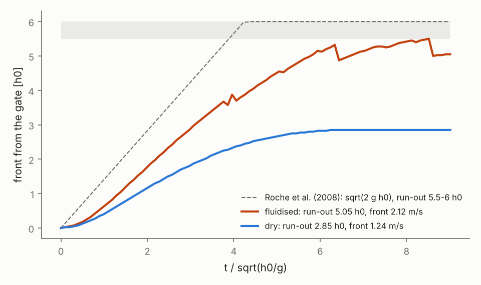
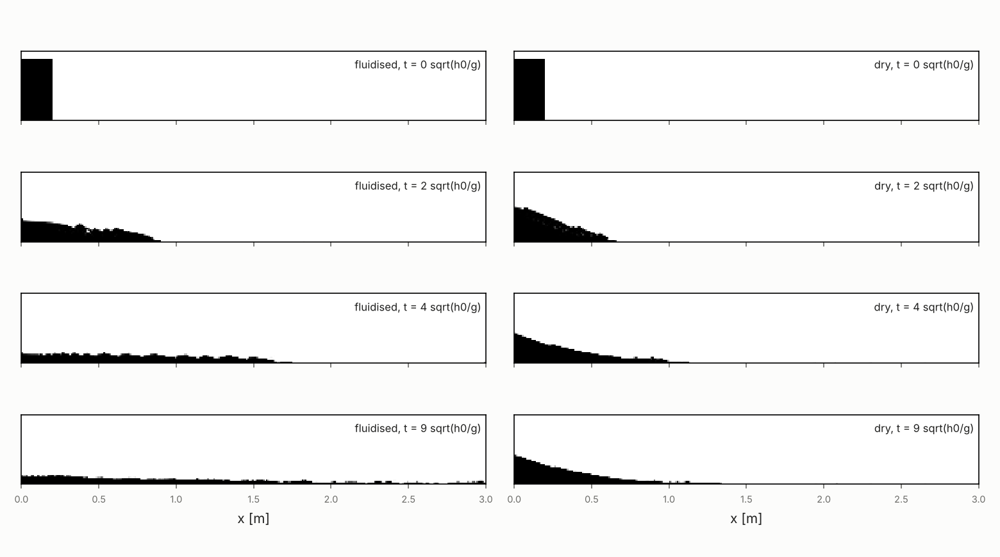

# fluidisedDamBreak: a fluidised column of fine beads collapsing

A column of fine glass beads, 0.2 m wide and 0.4 m high, stands against the end wall of
a long channel with its weight carried by air blown up through it. At t = 0 the gate
is gone and the column collapses. Because the pore pressure takes the grains' friction
away, the fluidised flow runs out more than twice as far as the same column dry. The
case reproduces the experiments of Roche et al. (2008, J. Geophys. Res. 113, B12203)
with the published model of the same experiments (route B: Gueugneau et al. 2017,
Aravena et al. 2021; WP F.8, decisions 0133, 0137, 0138).

## Setup

| | |
| --- | --- |
| Channel | 3.0 m long, 0.45 m high, open at the top; one cell (10 mm) deep |
| Column | 0.2 m wide (x0) and 0.4 m high (h0) against the left wall; the gate opens at t = 0 |
| Grains | glass beads, d 75 um, rho_p 2500 kg/m3, gas fraction 0.42 (expanded packing), bulk 1450 kg/m3 |
| Material | Mohr-Coulomb phi 24 deg (static angle of the beads), c 0, psi 0, E 1 MPa, nu 0.3; mu(I) with mu_2 tan 33 deg, I0 0.3; compaction cap (lambda* 0.0044 from 1 Pa: soft until it compacts by its 3.5 % expansion) |
| Walls | side walls smooth; floor 22 deg (Sia, WP F.8k); the reservoir's porous floor (`floorRes`, under the column) blows air at the rate that carries the column's weight |
| Start | pore pressure p = rho_b g (h0 - y) (fully supported, as in Roche's experiments); stress isotropic, the total stress -rho_b g (h0 - y) |
| Gas | route B: the pore pressure moves with the grains and diffuses with kappa = k p0/(mu e) = 0.110 m2/s (the packing's own value, no fit), and only lowers the friction (`frictionOnly`) |
| Mesh | square cells: 10 mm (300 x 45, default) or 5 mm (600 x 90, the validated mesh) |

`makeColumn.py` writes the start fields (`0/alpha`, `rho`, `p`, `sigma`) for the chosen
cell size; `dry/` is the same column without gas (`constant/gasProperties` removed, the
stress at rest with K0 = nu/(1 - nu)).

## The gas input

```
model        poreGas;
rhoP         2500.0;        // glass density [kg/m^3]
d            7.5e-05;       // bead diameter [m]
T            293.15;        // [K]
p0           101325.0;      // [Pa]; p is gauge
drag         ergunWenYu;
coupled      yes;
diffusivity  0.11;          // route B: the pressure is carried with the grains
                            // and diffuses [m^2/s]
frictionOnly yes;           // p lowers the friction only; the grains carry the
                            // support ratio p/P
inflow { floorRes 0.006478660196634505; }   // air through the reservoir floor [m/s]
```

`0/p`: `fixedValue` 0 at the open top, `fixedGradient` on `floorRes` (its flux is set by
`inflow`), `zeroGradient` on the walls. The material keywords first used here
(`overfillStress`, `yieldShearJump`, `slowFlowJump`, the cap's `capLambda` and
`capP0`) are commented in `constant/materialProperties` and listed in the manual.

## Numerics

- The solid as in version 1 (explicit Lagrange step plus remap, `maxCo 0.4`), with two
  rules for flowing granular material: no elastic shear jump between yielding cells
  (`yieldShearJump no`, decision 0137) and the normal jump between yielding cells
  scaled by the flow's Mach number (`slowFlowJump yes`, decision 0138). With them the
  collapse converges with the mesh: the front at 20 mm thickness agrees within 3.8 % on
  10, 5 and 2.5 mm cells (`tests/manual/test_collapse_convergence.sh`).
- Route B (decision 0133): each step the pressure is carried with the material across
  the faces (as its support ratio p/P with P the mean total stress, second order,
  bounded), then diffuses implicitly with kappa; void cells and the open surface are at
  p = 0 (WP F.8i). The pore pressure lowers the grains' friction: the yield uses
  sigma + p I.
- Gravity acts from the start, no damping (`damping 0`).

## How to run

```bash
source /usr/lib/openfoam/openfoam2512/etc/bashrc   # tools/setup_openfoam.sh installs it
./Allwmake                                          # from the repository root, once
cd tutorials/solidFluid/fluidisedDamBreak
./Allrun            # 10 mm cells: fluidised, then dry/; about 10 minutes each on one core
./Allrun 5 4        # 5 mm cells (the validated mesh; about 8 times the work) on 4 processors
./Allrun 10 1 gas   # only the fluidised run
python3 plot.py     # front.png, snapshots.png, front.txt (numpy, matplotlib)
./Allclean
```

The run writes every 0.02 s to 1.82 s, 9 sqrt(h0/g). A restart (`startFrom latestTime;`)
matches the continuous run bit for bit (the gas solver's state, including the support
ratios, is written in `<time>/uniform/poreGas`, WP F.9).

## Expected results



The front of the deposit (the end of the continuous material from the gate; grains
sprayed ahead do not count) against time, in Roche's units, from the run of this
tutorial as shipped (10 mm, 2026-11-27):

| | Run-out from the gate | Front speed, t/sqrt(h0/g) 1.5 to 4 |
| --- | --- | --- |
| Fluidised, 10 mm (this run) | 5.05 h0 (-12 % of 5.75) | 2.12 m/s (-24 % of sqrt(2 g h0) = 2.80) |
| Dry, 10 mm (this run) | 2.85 h0 (+8 % of 2.63, Breard et al. 2019) | 1.24 m/s |
| Fluidised, 5 mm (WP F.8k, `tests/manual/test_fluidised_collapse.sh`) | 6.24 h0 (+8.5 %) | 2.26 m/s (-19.5 %) |
| Dry, 5 mm (WP F.8k) | 2.73 h0 (+5 %) | |
| Roche et al. (2008), fluidised | 5.5 to 6 h0, stops at about 6.5 sqrt(h0/g) | sqrt(2 g h0) |

The fluidised column runs out about twice as far as the dry one: the pore pressure
carries the weight, so the grains have no friction until it diffuses away (time scale
h0^2/kappa = 1.5 s, about 7 sqrt(h0/g)). The front keeps a nearly constant speed while
the flow is supported, then slows and stops. It is 20 to 24 % slower than Roche's
sqrt(2 g h0): a column kept fully supported throughout reaches Fr 1.54, the
frictionless value 1.55 (Roche 1.41), so full support alone does not close the gap
(decision 0133). The front curve steps back where the thin sheet behind
the front breaks into patches less than half a cell thick.



Material fraction at t = 0, 2, 4 and 9 sqrt(h0/g): the fluidised column (left) spreads
as a thin flowing layer; the dry one (right) stops as a wedge from the wall.

`log.celFoam` shows the lift check's warning from the first steps (decision 0135): the
column is fluidised by design, and route B represents that support as lost friction,
with the grains at their packed density, as the published models of this experiment
do; the warning is expected here.

The run-out moves by several per cent with round-off alone (a run with E changed by
1e-13 gives 4.9 to 5.7 h0 on 10 mm, decision 0141), because the column starts at zero
effective stress, where round-off decides which cells yield first; the front speed
moves by about 1 %. Runs on more processors land in the same band. Read the numbers as
that band, and use the 5 mm mesh for comparisons (the 10 mm mesh cuts the thin sheet
at 10 mm).
