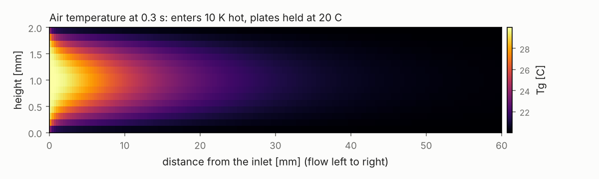
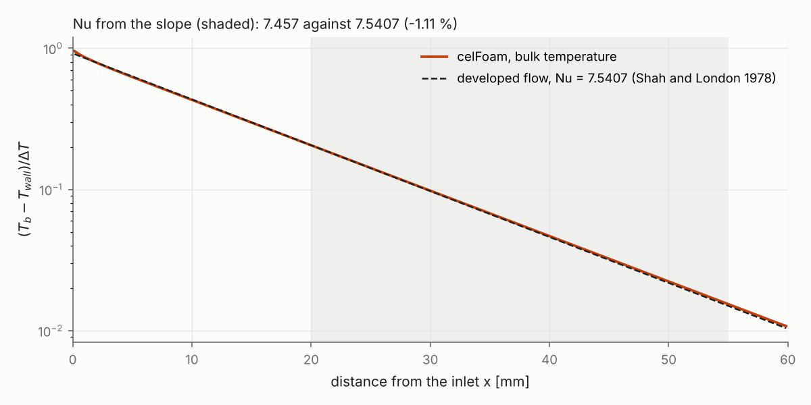

# heatedAirChannel: air cooled between two plates

Laminar air enters a 2 mm channel 10 K warmer than its walls and cools as it flows. The
air is in the void (no material), with its own momentum and temperature equations. After
the entry length the bulk temperature decays at the rate set by the developed Nusselt
number of plates at a fixed temperature, Nu = 7.5407 (Shah and London 1978). This is the
T.5 validation case (decision 0136) and the template for gas heat transfer in the empty
part of a vessel: the headspace above a bed, a hopper's air gap, an outlet duct.

## Setup

| | |
| --- | --- |
| Channel | H 2 mm high, 60 mm long, 200 x 16 cells; plates `bottom` and `top`, open ends `left` and `right` |
| Gas | air, `model gasFlow` (decision 0131): the whole domain is void (alpha 0) |
| Flow | starts from the developed Poiseuille profile at a mean 0.53 m/s (Reynolds about 140, Peclet about 50), driven by the pressure drop 12 mu u_m L/H^2 = 1.73 Pa between the ends; `initFields.py` writes both into `0/` |
| Temperature | `model twoTemperature`; the air enters at 30 C (`0.orig/Tg` fixedValue on `left`), the plates are held at 20 C (fixedValue) |
| Properties | air k_g 0.02569 W/(m K), c_g 1006 J/(kg K) |
| Run | 0.3 s (about three flow-throughs), written every 0.1 s |

`constant/thermalProperties`:

```
model        twoTemperature;  // the gas temperature Tg is solved in the void
c            1000;            // grains (none here)
conductivity constant;
k            0;
kGas         0.02569;         // air [W/(m K)]
cGas         1006.0;          // air [J/(kg K)]
```

`constant/gasProperties` has `model gasFlow` and the pressure tolerance; the material in
`constant/materialProperties` is never present, and its stiffness only sets the time
step. `initFields.py` holds the channel size and cell counts: change them with
`system/blockMeshDict`.

## Numerics

- Gas in the void: its own momentum equation, solved with PISO and the face-flux
  correction (`ddtCorr`), coupled to the pore gas solve (decision 0131).
- Temperature (decision 0136): the gas heat is carried with the gas mass fluxes
  (upwind), then conducted explicitly in the gas with the walls' fixed temperature.
  Upwind transport adds about 1.1 % to the developed Nusselt number here, axial
  conduction about 0.3 %.
- Time step about 4e-5 s (`maxCo 0.4` of the solid's limit; gasFlow is not stable at
  2e-4 s on these cells); 7,500 steps.
- The energy balance in `log.celFoam` stays at round-off (1e-17 J of 5e-3 J).

## How to run

```bash
source /usr/lib/openfoam/openfoam2512/etc/bashrc
./Allwmake                    # from the repository root, once
cd tutorials/solidFluidThermal/heatedAirChannel
./Allrun                      # about 100 seconds on one core
./Allrun 4                    # on 4 processors
python3 plot.py               # temperature.png, bulk.png, results.txt
./Allclean
```

`tests/test_thermal_tutorials.sh` runs it for 0.02 s; `tests/test_void_heat.sh` and the
thermal validation pack check it against Nu = 7.5407.

## Expected results





The warm core cools toward the plates, and after a few millimetres the bulk
(flow-weighted) temperature difference decays exponentially. From its slope between 20 and
55 mm (shaded), the developed Nusselt number is 7.457 against 7.5407 (-1.1 %); `plot.py`
prints it.
