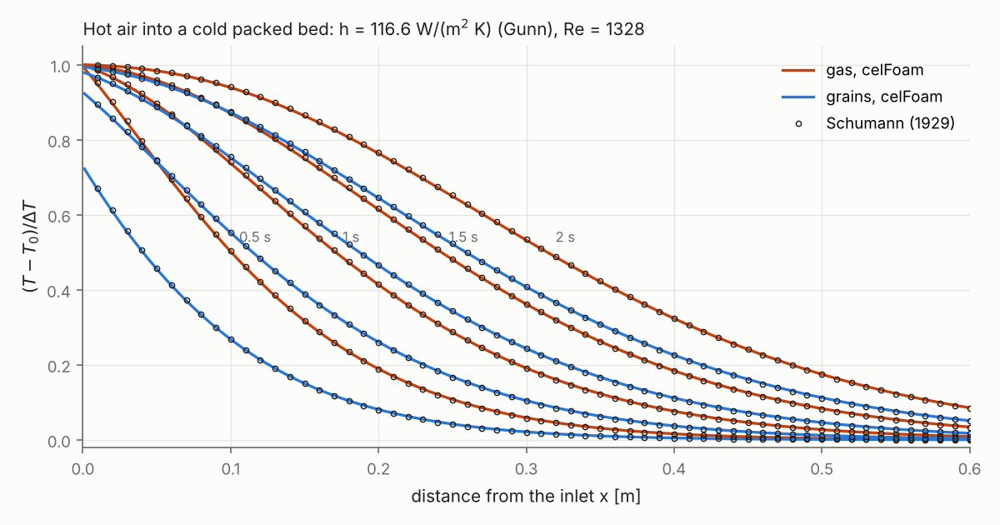

# hotAirPackedBed: hot air blown into a cold packed bed

Air 100 K hotter than a packed bed of 20 mm grains is blown through it. The gas and the
grains each have their own temperature, and heat passes between them at Gunn's (1978)
coefficient. The thermal front moves along the column, and its shape matches the closed
form of Schumann (1929). This is the T.4 validation case (decision 0136) and the
template for gas flowing through a heated or cooled bed: regenerators, dryers, packed-bed
heat storage.

## Setup

| | |
| --- | --- |
| Column | 0.6 m long, 300 cells of 2 mm, one cell across (1D) |
| Bed | rigid (no gravity, gas not coupled to the grains), gas fraction 0.4, grains 20 mm, rho_P 2650 kg/m3 |
| Gas | air, `model poreGas`, drag `ergunWenYu`; blown in through `left` at 1 m/s superficial (`inflow`), out at `right` (p = 0 gauge) |
| Temperature | `model twoTemperature`: grains `T` and gas `Tg` start at 20 C; the air enters at 120 C (`0.orig/Tg` fixedValue on `left`) |
| Properties | grains c 5 J/(kg K) (kept small so the front crosses in 2 s), no conduction (`k 0`; Peclet number about 1e4); air c_g 1006 J/(kg K), k_g 0.02569 W/(m K) |
| Run | 2 s, written every 0.5 s |

`constant/thermalProperties`:

```
model        twoTemperature;  // grains T and gas Tg
c            5.0;             // grain specific heat [J/(kg K)]
conductivity constant;
k            0;               // grain conduction [W/(m K)]
kGas         0.02569;         // air [W/(m K)]
cGas         1006.0;          // air [J/(kg K)]
// variableGas yes;           // gas density, viscosity, conductivity from Tg (WP T.7)
```

`constant/gasProperties` sets the pore gas (decision 0127): grain size `d`, grain
density `rhoP` (the gas fraction is 1 - rho/rhoP), the drag law and the inflow speed.
The temperature model needs no gas keyword of its own.

## Numerics

- Gas: pressure from the Darcy-Forchheimer mass balance in the pores, solved implicitly
  each step (decision 0127); the bed does not move.
- Temperature (decision 0136): the gas heat is carried with the gas mass fluxes (upwind),
  then the grain-gas exchange h a_s (T - Tg) is solved implicitly per cell, so the stiff
  exchange (time scale about 0.01 s here) does not limit the step. h is Gunn's (1978)
  correlation at each cell's Reynolds and Prandtl numbers; a_s = 6 (1 - e)/d.
- Time step from the solid's CFL limit (`maxCo 0.4`), about 2.7e-4 s; 7,300 steps.
- `log.celFoam` prints the energy balance (thermal energy - start - heat in - heat
  carried in) at each write: round-off, about 2e-14 J of 6 J.

## How to run

```bash
source /usr/lib/openfoam/openfoam2512/etc/bashrc
./Allwmake                    # from the repository root, once
cd tutorials/solidFluidThermal/hotAirPackedBed
./Allrun                      # about 15 seconds on one core
./Allrun 2                    # on 2 processors
python3 plot.py               # profiles.png, results.txt (numpy, matplotlib)
./Allclean
```

`tests/test_thermal_tutorials.sh` runs it for 0.5 s; `tests/test_gas_heat.sh` and the
thermal validation pack (`tests/validation/thermal`) check it against Schumann.

## Expected results



The gas (orange) runs ahead of the grains (blue); with h = 116.6 W/(m2 K) at a particle
Reynolds number of 1328 the two stay close. Every profile lies on Schumann's closed form
(circles, with Gunn's h): the largest difference is 0.5 % of the inlet step for the gas
and 0.4 % for the grains. `plot.py` prints these numbers. The front speed follows the
heat capacities: doubling the grain c halves it.
