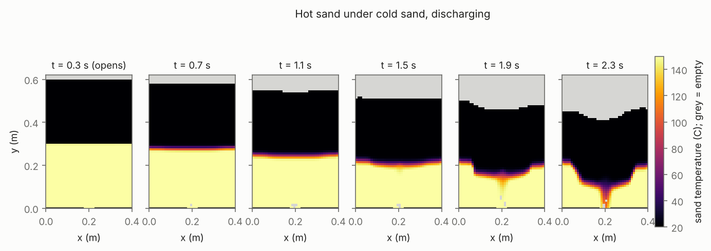
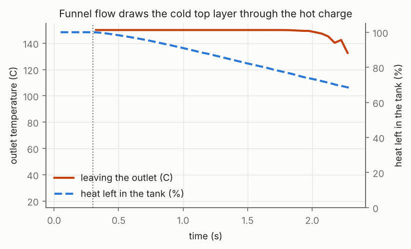

# hotSiloDischarge: hot sand under cold sand, discharging

Sia's target tank (T0, as `solid/siloDischarge`) with **temperature** (version 2, WP
T.8, decision 0136). The lower half of the fill is hot sand at 150 C, the upper half
cold sand at 20 C. The material settles for 0.3 s with the outlet closed, then the
outlet opens. The temperature moves with the sand, so it shows which material leaves
first: in this flat-bottomed tank the flow is a funnel above the outlet, which draws the
cold top layer down through the hot charge while the hot sand in the corners stays put.

This case has no pore gas, so it is the simplest template of the solid-fluid-temperature
category: add `constant/gasProperties` (see the `solidFluid` tutorials) and set
`model twoTemperature` to give the gas its own temperature.

## Setup

| | |
| --- | --- |
| Tank | 0.40 m wide, filled to 0.60 m, lid at 0.70 m; outlet 0.06 m wide in the middle of the floor, opens at 0.3 s |
| Material | rho 1800 kg/m3, E 10 MPa (T0), nu 0.3, Mohr-Coulomb phi 35 deg, c 0, psi 0, T0 rule set (decision 0050); wall friction 20 deg |
| Temperature | lower layer (y < 0.3 m) 150 C, upper layer 20 C; dry quartz sand, c 800 J/(kg K) (Incropera et al., Table A.3, sand) |
| Conduction | Zehner-Schluender from the packing in each cell, quartz grains 3 W/(m K) in air: about 0.25 W/(m K) |
| Walls | left and right convective, h 10 W/(m2 K) to 20 C outside; floor and lid adiabatic |
| Mesh | 10 mm square cells, 40 x 70, one cell deep (`system/blockMeshDict`) |

`constant/thermalProperties` switches temperature on; without it (or with `model none`)
celFoam runs exactly as without temperature.

```
model        equilibrium;     // one temperature per cell; twoTemperature adds the
                              // pore gas's own temperature Tg (needs gasProperties)
c            800;             // specific heat of the grains [J/(kg K)]
conductivity zehnerSchlunder; // or constant with k [W/(m K)]
kParticle    3;               // grain material [W/(m K)]
kGas         0.02569;         // gas in the pores [W/(m K)]
rhoP         2650;            // grain density [kg/m^3]
limiter      MC;              // remap limiter of T (default)
voidT        293.15;          // written in empty cells [K]
walls
{
    left  { h 10; Tinf 293.15; }   // convective; { q 1000; } is a heat flux [W/m^2]
    right { h 10; Tinf 293.15; }
}
```

Two more entries (WP T.7, both off by default):

- `variableGas yes;` makes the pore gas density (ideal gas, mass kept when the gas heats
  or cools in a closed pore), viscosity (Sutherland) and conductivity (Sutherland form
  for air) follow the gas temperature. It needs `constant/gasProperties`.
- `plasticHeating 0.9;` (Taylor-Quinney fraction beta, 0 to 1) heats the material by
  beta times the plastic work. In this tank it adds about 1 J, about 1e-5 K.

The start time holds `0/T` (kelvin); its patch types are the other thermal boundary
conditions (`fixedValue`, `zeroGradient` adiabatic, `fixedGradient` a flux). Here
`setFields` (`system/setFieldsDict`) writes the two layers.

## Numerics

- Solid: as `solid/siloDischarge`. Explicit Lagrange step plus remap onto the fixed mesh
  (decision 0013), time step from the CFL limit with `maxCo 0.4`; gravity ramps in over
  0.1 s and the velocity is damped at 250 1/s until the outlet opens (decision 0020).
- Temperature (decision 0136): the energy is carried by the remap with the material
  mass, with the MC limiter (`limiter`), so a cell's temperature never leaves the range
  of its neighbours. Conduction is an explicit finite-volume step after the remap,
  sub-cycled when the solid step exceeds half its explicit limit (here it never does:
  the conduction limit is about 140 s against a 1e-5 s solid step).
- Walls: the convective walls add h (Tinf - T) over the wall face; an outlet carries the
  leaving material's heat out with it; void cells hold `voidT` and no heat.
- Temperature does not act back on the flow (no thermal stress, no temperature-dependent
  friction; decision 0136).
- At each write `log.celFoam` prints the thermal energy, the heat in through the walls,
  the heat carried in through inlets and out through outlets, and their balance, which
  is round-off (about 1e-8 J of 1.2 MJ here).

## How to run

```bash
source /usr/lib/openfoam/openfoam2512/etc/bashrc
./Allwmake                    # from the repository root, once
cd tutorials/solidFluidThermal/hotSiloDischarge
./Allrun                      # E = 10 MPa, about 10 minutes on one core
./Allrun 0.1                  # softer material, about a minute
./Allrun 10 4                 # on 4 processors
python3 plot.py               # snapshots.png, outlet.png, outlet.txt (numpy, matplotlib)
./Allclean
```

`tests/test_hot_silo_tutorial.sh` runs it at 0.1 MPa to 0.8 s and checks the energy
balance (1e-12), that the sand leaving is at 150 C and that no cell leaves 20 to 150 C.
`tests/test_thermal_tutorials.sh` checks this README and the folder layout.

## Expected results

At 10 MPa and 10 mm cells:





The sand leaves at 150 C for 1.5 s, until the cold layer, drawn down the funnel above
the outlet, reaches it (about 1.9 s); the outlet temperature then falls (133 C by 2.3 s)
while hot sand stays in the corners. About 32 % of the heat has left with the sand. The
side walls lose little in 2 s (conduction moves heat less than 1 mm in that time), so the
heat left in the tank falls only because hot sand leaves.
