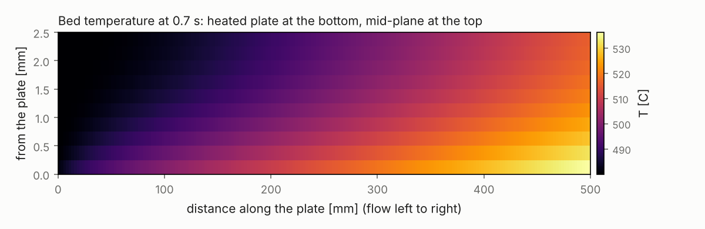
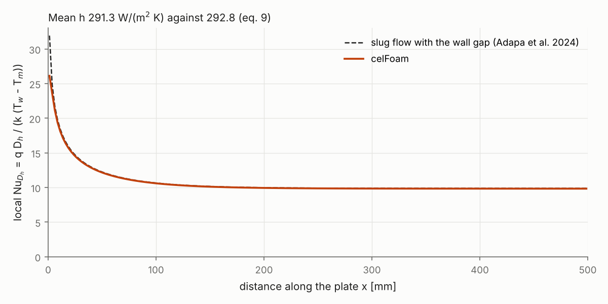

# movingBedHeatedWall: particles flowing past a heated plate

Hot ceramic particles flow in plug flow down a 5 mm gap between two plates that heat them
with a uniform flux, the particle heat exchanger of Adapa et al. (2024, arXiv
2403.19892). The heat enters through a thin air gap at the wall and conducts into the
moving bed. The local and mean heat transfer coefficients match the slug-flow solution
of Adapa et al. This is the T.6 validation case (decision 0136) and the template for
moving-bed heat exchangers, coolers and heaters.

## Setup

| | |
| --- | --- |
| Geometry | half the gap (b 2.5 mm, 10 cells) by 500 mm heated length (200 cells); the mid-plane `mid` is a smooth adiabatic wall |
| Material | CARBO HSP 40/70 (d 404 microns), flowing bulk density 2090 kg/m3; elastic, no gravity, no wall friction: plug flow |
| Flow | fed through `inlet` at 1 m/s (`inlets`), out through the open `outlet` (`outlets`) |
| Temperature | `model equilibrium`; the bed enters at 480 C (`0.orig/T` fixedValue on `inlet`) |
| Bed properties | k_eff 0.28 W/(m K) and near-wall gap D_air 35 microns at 480 C and 10 mm/s (Adapa et al., Table 5); c 1100 J/(kg K) (not in the paper; 900 or 1300 move h by 1 %) |
| Wall | uniform flux q 5000 W/m2 on `wall` (`walls { wall { q 5000; } }`) |
| Run | 0.7 s (1.4 transits), written every 0.1 s |

The experiment moves at 10 mm/s. To keep the run short the bed moves at 1 m/s with c
scaled by 0.01 (`c 11` in `constant/thermalProperties`), so the Peclet number
U D_h rho c/k_eff = 821 and every dimensionless result are those of the experiment.

```
model        equilibrium;
c            11.0;            // 1100 J/(kg K) x 0.01 m/s / 1 m/s
conductivity constant;
k            0.28;            // [W/(m K)]
voidT        753.15;          // written in empty cells [K]
walls
{
    wall { q 5000.0; }        // heat flux into the bed [W/m^2]
}
```

## Numerics

- Solid: explicit Lagrange step plus remap onto the fixed mesh (decision 0013); the
  inlet adds material each step and the open outlet lets it leave.
- Temperature (decision 0136): T is carried by the remap with the material mass, with
  the MC limiter (superbee would turn the smooth profile into steps, local Nu off by
  20 %), then an explicit conduction step with the wall flux. The near-wall gap is not in
  the solver: like Adapa et al. (eq. 2), the plot adds the series resistance
  R_nw = D_air/k_air to the wall temperature.
- Time step from the CFL limit (`maxCo 0.4`), about 8.5e-5 s; 8,200 steps.
- The energy balance in `log.celFoam` stays at round-off (6e-14 J of 5.4 J).

## How to run

```bash
source /usr/lib/openfoam/openfoam2512/etc/bashrc
./Allwmake                    # from the repository root, once
cd tutorials/solidFluidThermal/movingBedHeatedWall
./Allrun                      # about 45 seconds on one core
./Allrun 4                    # on 4 processors
python3 plot.py               # temperature.png, nusselt.png, results.txt
./Allclean
```

`tests/test_thermal_tutorials.sh` runs it for 0.1 s; `tests/test_moving_bed_heat.sh` and
the thermal validation pack check it against Adapa et al.

## Expected results





The bed heats from the plate side; the thermal boundary layer grows along the plate
until it reaches the mid-plane after about 200 mm, where the local Nusselt number levels
off. Past x = 50 mm the local Nusselt number is within 0.7 % of the slug-flow solution
(Adapa et al., eq. 4 with the gap). The mean h over the plate is 291.3 W/(m2 K) against
292.8 from their eq. 9 (-0.5 %), inside the 225 to 350 W/(m2 K) they report for a 5 mm,
500 mm plate exchanger.
