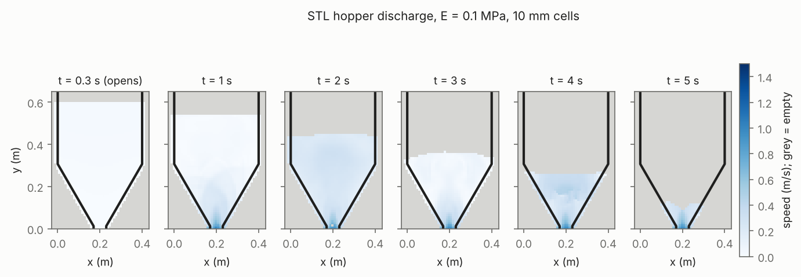
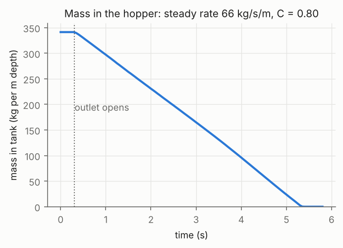

# stlHopper: a 60 deg hopper from STL walls

The stlSilo tank (T0 material) with its flat floor replaced by two STL hopper walls at
60 deg to the horizontal (half angle 30 deg), meeting the side walls at y = 0.32 m and
leaving a 0.06 m gap over the mesh outlet patch (WP 4.5, decisions 0047, 0051, 0052).
The hopper walls cut the 10 mm mesh at every angle. Material settles for 0.3 s with the
outlet closed, then the hopper runs empty.

| | |
| --- | --- |
| Walls | STL bodies `leftWall`, `rightWall`, `leftHopper`, `rightHopper` (constant/triSurface), friction 20 deg |
| Fill | to y = 0.61 m, void above |
| Material | as siloDischarge (Mohr-Coulomb phi 35, c 0, mu(I) placeholders); E = 0.1 MPa by default |
| Mesh | 46 x 65 cells of 10 mm, one cell deep |

## How to run

```bash
source /usr/lib/openfoam/openfoam2512/etc/bashrc
cd tutorials/stlHopper
./Allrun          # E = 0.1 MPa, runs to empty, about 2 minutes
./Allrun 10       # T0 stiffness, about 25 minutes
python3 plot.py   # snapshots.png, mass.png, rate.txt (needs numpy, matplotlib)
./Allclean
```

## What it shows (0.1 MPa, 10 mm)





- Mass flow: the whole fill moves and the hopper empties completely (no dead zones on
  the 60 deg walls), 5 s after opening.
- Steady rate 66 kg/s per metre of depth, the same as the flat STL tank (68.8, bands of
  three runs, `tests/test_stl_silo.sh`). The Rose-Tanaka correlation predicts about
  1.2 times the flat-bottom rate for a 30 deg half angle; the correlations are for 3D
  orifices and measured materials, so no pass band is set until Sia agrees one.
