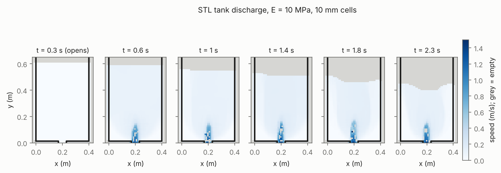
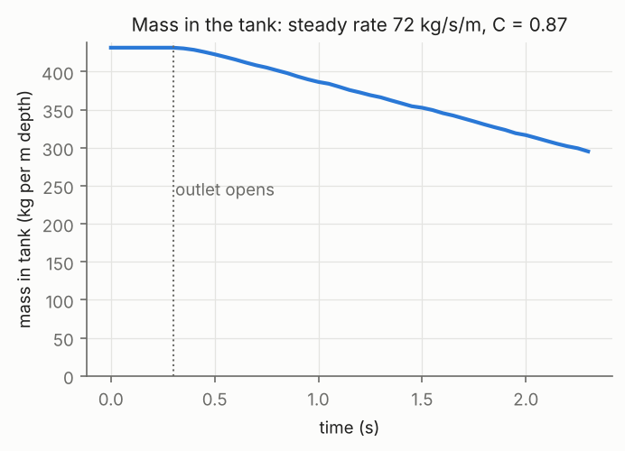

# stlSilo: the T0 tank built from STL walls

The siloDischarge tank (Sia's target problem T0) with its side walls and floor given as
STL surfaces instead of mesh boundaries (WP 4.3c, decisions 0047 and 0049). The walls
cut the 10 mm mesh at a quarter and three quarters of a cell, there is void above the
material, and the outlet is the mesh patch under the gap in the STL floor: closed while
the material settles for 0.3 s, then open for 2 s.

| | |
| --- | --- |
| Tank | STL bodies `leftWall`, `rightWall`, `leftFloor`, `rightFloor` (constant/triSurface): 0.40 m wide (x 0 to 0.40), floor at y = 0.0125, gap 0.06 m (x 0.17 to 0.23) |
| Fill | 0.6 m above the floor (setFields), void above |
| Material | as siloDischarge: rho 1800, E 10 MPa, nu 0.3, phi 35 deg, c 0, mu(I) placeholders |
| Friction | 20 deg on every STL body (`friction` in constant/rigidBodies) |
| Outlet | mesh patch `outlet` under the gap, friction 20 deg until it opens at 0.3 s |
| Mesh | 46 x 65 cells of 10 mm, one cell deep; the STL tank does not follow it |

## How to run

```bash
source /usr/lib/openfoam/openfoam2512/etc/bashrc   # tools/setup_openfoam.sh installs it
./Allwmake                                          # from the repository root, once
cd tutorials/stlSilo
./Allrun          # E = 10 MPa, about 9 minutes on one core
./Allrun 0.1      # softer material, about a minute
python3 plot.py   # snapshots.png, mass.png, rate.txt (needs numpy, matplotlib)
./Allclean
```

`alpha` is the material fraction of the open part of each cell (the part not inside a
body). Field `alphaBody` (written with the others) shows the walls in ParaView.

## What it shows (10 MPa, 10 mm)





- No material leaves while the outlet is closed: the mass stays at 431.5 kg/m to 1e-15
  through the settling, so nothing leaks through the STL walls or floor.
- The flow looks like the mesh-wall tank: a fast stream over the gap, a slower
  converging zone, the top coming down nearly level.
- Steady rate 72 kg/s per metre of depth (Beverloo C = 0.87). The mesh-wall tank
  (siloDischarge) gives 57.5 through celFoam and 67.7 through the test driver at the
  same settings; single 10 mm rates scatter by about 15 % from round-off (decision
  0046), so this is no measurable difference yet. Comparing the rates properly, and a
  hopper, is WP 4.5.
